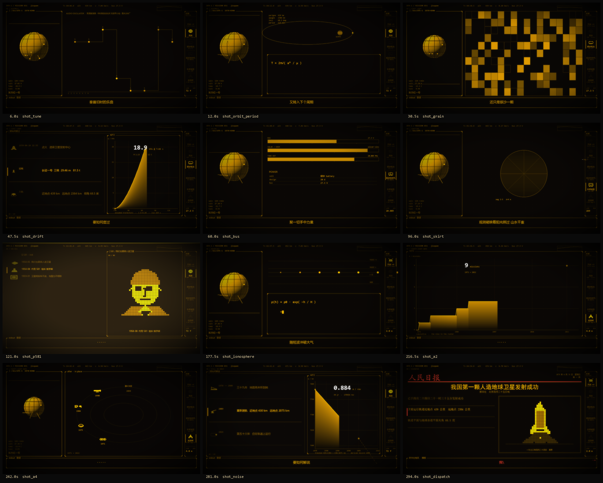

# 《东方红一号》代码渲染 MV



一支用代码逐帧渲染的终端风格 MV，**非官方同人作品**。
每一帧都是歌曲时间 t 的纯函数：没有剪辑软件，没有手工关键帧，没有外部图片素材。
画面里的每一个像素——卫星、火箭、地图、报纸、公式、仪表——都是程序当场画出来的。

- 成片：1280×720 / 24 fps / 5:30，琥珀色荧光屏调色板
- 主题：中国第一颗人造卫星的研制、播送，与它 56 年后仍在天上这件事
- 代码 [MIT](LICENSE)（© 2026 苌萌萌）；歌曲与歌词**不在本仓库**，见 [NOTICE.md](NOTICE.md)

*English: the complete source of a code-rendered, unofficial fan MV about Dongfanghong-1,
China's first satellite. Every frame is a pure function of song time, drawn entirely with PIL -
no footage, no imported artwork. Bring your own copy of the song, then run `python build.py all`.
The code is MIT; the song, the lyrics and the fonts are not included (see [NOTICE.md](NOTICE.md)).*

```bash
git clone https://github.com/InariNGT-Ofiicial/DS-DFH-1.git
cd DS-DFH-1 && pip install -r requirements.txt
```

---

## 这是什么

一支 MV 的**全部出片代码**。复现它需要两样东西，都得你自备：**音频**和**歌词**。
剩下的（时钟标定、分镜表、场景库、渲染、编码、验收）都在这里。

它的技术路线来自另一支片：参考项目把「帧 = t 的纯函数」这条路线跑通了，本片把**内容层整个换掉**，
证明了那条路线是**可移植的**——换掉 `LAYOUT` 表，范式不动，出来的是另一支完全不同的片子。

| | 参考项目 `world-execute-me-dsh-pv` | 本片 |
|---|---|---|
| 主体「她」 | 鲸鱼少女立绘 | **东方红一号卫星**，程序化绘制，零外部素材 |
| 叙事 | 大模型的训练史 | 中国第一颗人造卫星的研制与播送 |
| 时钟 | 130.000 BPM / 211.91 s | **72.072 BPM / 330.069 s** |
| 镜头 | 79 镜 | **59 镜** |
| 章节 | 00 BOOT … 09 WHALE_FALL | 00 PRE-FLIGHT … 10 SUNRISE |

## 快速开始

需要：
- **Python 3.12+**，装上 `pip install -r requirements.txt`（实际只有 Pillow 和 numpy 是硬依赖）
- **ffmpeg** 在 `PATH` 里（或用 `PV_FFMPEG` 指定路径）
- **字体**：见 [docs/FONTS.md](docs/FONTS.md)，全部可用环境变量覆盖

```
# 1. 自备歌曲（见 NOTICE.md，本仓库不含音频）
cp /your/copy/song.mp3 audio/song.mp3
#    起唱点必须与 song.timeline.json 对得上，check 会用 sha256 校验

# 2. 自备歌词（本仓库只带时间码，不带文字）
python tools/lrc.py /your/copy/lyrics.lrc --json
#    会逐行比对 sha256 与时间漂移，对不上就报错

# 3. 出片
cd pv
python build.py all            # check -> render -> encode -> verify
```

- **输出**：`out/sirius_pv.mp4` 是交付版（1280×720 / crf 16 / AAC）；
  `out/sirius_master.mkv` 是无损母带（utvideo/gbrp + FLAC，约 3.8 GB，**多数播放器解不动**，
  它是取证物不是交付物）。
- **耗时**：全片 7922 帧，4 worker 约 **4 分钟**渲染（CPU，实测中位 84 ms/帧）。
  并发数请**按内存定，不要按核数**——这个坑很贵，见 [docs/DEVLOG.md](docs/DEVLOG.md)。
- **分步**：`python build.py <check|render|encode|verify>`，每段独立可跑。
  建议先 `python build.py render --frames 48` 出标定片。

## 三条不变量

整支片子建立在三件事上，改任何一处都会连带改掉别的：

1. **帧 = 歌曲时间 t 的纯函数。** 没有剪辑软件、没有手工关键帧、没有时间轴拖影
   （拖影会让帧依赖上一帧，破坏可复算与分块并行）。红利：可逐像素验证、可任意分块并行。
2. **固定五层合成序。** 场景 → 跨切搬运的物件 → 主体 → chrome（每帧重画、永不参与变换）→ 后期。
   chrome 不参与变换，所以画面再乱也不会散架。
3. **分镜是声明式三张表 + 一条 lint + 一条弧线，不是文档。** 文档会腐坏、不能 diff；
   表能 lint、能一键重算。见 `pv/direction.py`。

## 仓库结构

```
pv/            出片工程本体
  pvclock.py     时钟层：BPM、章节、歌词行、情绪弧 ui_gain(t)、辉光弧 glow_arc(t)
  direction.py   分镜三表：SHOTS / CHOREO / lint + 全部镜头声明
  scenes.py      场景库：元素函数（她 / 轨道 / 频谱 / 火箭 / 公式 / 面积图 / 结构拆解…）
  bigscene.py    大场景：44×30 字符网格的人物、事件、场景
  icons.py       器件图元：航天器、卫星部件
  chinamap.py    中国地图（Albers 投影 + 南海诸岛插框 + 审图号）
  prims.py       绘图原语（精灵、光晕、热力图）
  tuikit.py      终端风图元（调色板、字体、扫描线、暗角、网格遮罩）
  engine.py      合成器：五层合成序 + 后期
  facts.py       事实层：所有上屏数字**只在这里改**，逐条注明出处与口径
  check.py       lint：分镜变量、时钟、空隙
  build.py       出片流水线：check -> render -> encode -> verify
tools/         标定与验收工具
  analyze.py     谱通量 / 自相关 BPM / 7 频段
  calib.py       用歌词行间距反推 BPM + 生成版权安全时间轴
  lrc.py         LRC 解析：把你的 .lrc 转成 lines.local.json（含 sha256 校验）
  aero_probe.py  把 facts 的真参数代进空气动力学公式，含口径三分类
  aero_mock.py   四版样张标定（线 / 白热 / 面积 / 面积+白热）
  tofu_audit.py  全片字符审计：真比对字形，抓「中文被塞进等宽字体」
  ab_loci.py     同帧 A/B：只换元素，差就是改动本身
  ab_sec07.py    07 段同帧 A/B：修「段落级重复」（lint 判不出）
  sheets_sec07.py 07 段分镜三表快照
  contact.py     抽帧贴联系表
docs/          文档
  DEVLOG.md      工程日志：整个过程、犯过的错、改掉的判断
  HOW_IT_WORKS.md 流水线是怎么运作的
  PORTING.md     与原稿的差异台账（含未核实项）
  FONTS.md       字体清单与替代方案
research/      前期研究（逆向、创意分析、取证、复现）
assets/        影片静帧与对照图（preview 及 A/B 证据）
licenses/      第三方内容合规说明
work/          工作目录
  map/           地图数据（审图号 GS(2019)1719号，**随仓库分发**）
  lines.local.json  你的歌词（**自备，不入库**，见 .gitignore）
audio/         你的歌曲（**自备，不入库**）
out/           输出（**不入库**）
```

## 验收

判据是**逐像素**的，不是「看着像」：

```
python build.py verify
```

它从源码**当场**重渲若干时刻的静帧，与母带对应帧逐像素比对。
若 **MAE 恰为 0**，一次测量同时证明了两件事：**画面是在本机生成的**，且**渲染是确定性的**。

本片定稿的结果：**MAE 0.000 × 22 点 / identical 100.0%**。

## 不在仓库里的，以及替代办法

| 东西 | 为什么 | 替代办法 |
|---|---|---|
| 歌曲音频 | 版权 | 自备，放到 `audio/song.mp3`；`check` 会核对起唱点 |
| 歌词原文 | 歌词版权 | 自备 LRC，`tools/lrc.py --json` 转成本机可用的格式 |
| Consolas / 微软雅黑等字体 | 不可再分发 | 用本机的，或用环境变量换成别的，见 [docs/FONTS.md](docs/FONTS.md) |
| 参考项目的角色立绘 | 本片不用它（主体是程序化绘制） | 不需要 |

## 与原始分镜的差异、以及未核实项

见 [docs/PORTING.md](docs/PORTING.md)，逐条列明，包括：
`F_HEAD` 字体替代、母带编码器选择、主体是示意性绘制而非照片级复原、
`el_her` 的三条读数（电压/温度/调谐）是**艺术化演出不是遥测实录**、
以及音画对齐**只做到镜头边界对齐唱词起音，未做逐字对齐验收**。

**以上比对均为抽点验证，不表示每一帧都满足同样指标。**

---

*这是非官方同人作品，与任何机构、作者没有从属或合作关系。*
